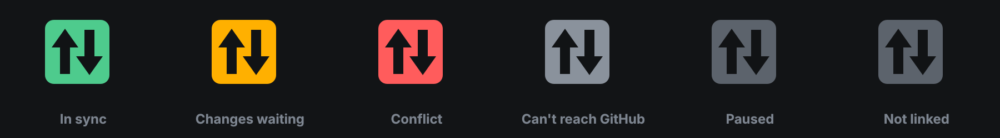

# ghsync

Keep a local folder and a GitHub repository in sync **without git** and without the 100-file browser upload limit. A single-file command-line tool, plus a dark industrial desktop GUI with a tray watcher that tells you when changes are waiting.


## Why

Uploading through github.com stops at 100 files per upload, and checking whether a local project still matches the repo meant downloading the zip and comparing folders in WinMerge. `ghsync` does that comparison for you and talks to GitHub's API directly, so any number of files goes up in one go.

## Features

- **No git required.** Pure Python standard library (3.8+) for the CLI. Only the GUI needs PyQt6.
- **No 100-file limit.** Files are uploaded through the GitHub REST API (Git Data endpoints).
- **Knows who changed what.** A three-way comparison (last synced state, your folder, GitHub) separates "changed here", "changed on GitHub" and "changed on both".
- **Conflicts are never overwritten.** Files changed on both sides are reported and left alone until you pick a side.
- **Safe by default.** `--dry-run` shows the plan, deletions ask for confirmation, and every transfer is hash-verified.
- **Never writes outside the folder.** Paths from GitHub are checked before anything touches the disk, and ghsync refuses to go through symlinks or junctions.
- **Only real deletions are deleted.** A file that is ignored, too big, unreadable or behind a link is *held*: left alone on both sides, never treated as deleted.
- **Your edits win a race.** If you save a file while a pull is running, that file is skipped, not overwritten.
- **Desktop GUI** with a live change list, coloured diffs, one-click push/pull/sync and per-file conflict resolution.
- **Tray watcher.** Polls the folder and GitHub in the background, shows a status-coloured tray icon and sends a notification when something new is waiting. It only notifies; it never syncs on its own.

## Requirements

- Python 3.8 or newer
- A GitHub personal access token (see below)
- `pip install PyQt6` for the GUI only

## Quick start

**1. Get a token.** On GitHub go to *Settings → Developer settings → Personal access tokens → Fine-grained tokens* and create one limited to the repositories you sync, with **Contents: read and write**. Add **Administration: read and write** only if you want `init` to create repositories for you. A classic token with the `repo` scope also works, but it can reach every repository you own.

**2. Sign in once.**

```
python ghsync.py login
```

The token is stored in `~/.ghsync_token` (plain text, so treat that file like a password). Alternatively set the `GITHUB_TOKEN` environment variable.

**3. Link a folder.** Run inside your project folder, or point at it with `-C <folder>`.

```
python ghsync.py init my-project            # create a new private repo and upload the folder
python ghsync.py init my-project --public   # ...or a public one
python ghsync.py link owner/repo            # ...or link a repo that already exists
```

Linking an existing repo is the easy way to adopt a project you previously uploaded by browser: identical files show as in sync and only the real differences appear.

**4. Sync.**

```
python ghsync.py status     # what would be pushed / pulled / in conflict
python ghsync.py diff       # show the differences
python ghsync.py sync       # pull, then push
```

## Command reference

Global option: `-C <folder>` runs against a folder other than the current one (put it before the command: `python ghsync.py -C D:\site status`).

| Command | What it does |
|---|---|
| `login` | Store your GitHub token. |
| `init <name> [--public] [--org ORG] [--description TEXT] [-m MSG]` | Create a repo on GitHub, link this folder and upload everything. |
| `link <owner/repo> [--branch NAME]` | Link this folder to an existing repo (default branch unless given). |
| `status` | Compare folder and repo and show the plan. Changes nothing. |
| `diff [paths...]` | Unified diff, GitHub to local. Binary files just report that they differ. |
| `push` / `pull` / `sync` | Send local changes, fetch remote changes, or both. |

Options for `push`, `pull` and `sync`:

| Option | Meaning |
|---|---|
| `-m "message"` | Commit message (default: `ghsync: N file(s) changed (timestamp)`). |
| `--dry-run` | Print the plan and stop. |
| `--yes` | Skip the deletion confirmation. |
| `--prefer local\|remote` | Resolve every conflict in favour of one side. |

Each sync is one commit containing all the changes. It appears under your GitHub account.

## The GUI

```
python ghsync_gui.py                      # opens the last folder you used
python ghsync_gui.py C:\Projects\my-site  # opens a specific folder
python ghsync_gui.py C:\Projects\my-site --tray   # starts hidden in the tray
```

Keep `ghsync_gui.py` in the same folder as `ghsync.py`.

- **First run on a folder:** save your token, then either create a new repo from the folder or link an existing one.
- **Counters and list:** PUSH, PULL, CONFLICT and IN SYNC counts sit above the list of every pending file, tagged ADD, MOD or DEL.
- **Actions:** SYNC, PUSH, PULL, REFRESH (or F5), plus an optional commit message. Double-click a file or press DIFF for a coloured diff.
- **Conflicts:** select the conflicting files and choose **KEEP LOCAL** (overwrite GitHub) or **KEEP GITHUB** (overwrite your copy). Each asks for confirmation.
- **Deletions** always ask first. The window also refreshes when you click back into it.

### Tray mode



Tick **WATCH FOLDER** at the bottom of the window (on by default). While it is on:

- The folder is checked every 5 seconds and GitHub's latest commit once a minute. A change is only re-compared after the folder has been quiet for one poll, so saving many files doesn't cause a flurry of checks.
- When something new is waiting you get a notification such as *"3 to push · 2 to pull"* with the first few file names. You get one per distinct set of changes, and none while the window is in front of you.
- Closing the window hides it to the tray. Right-click the icon for **Open**, **Sync now**, **Pause/Resume watching** and **Quit**.

To start it with Windows, put a shortcut to `pythonw ghsync_gui.py <folder> --tray` in the `shell:startup` folder. The polling rates are `LOCAL_POLL_MS` and `REMOTE_EVERY` at the top of the `Main` class in `ghsync_gui.py`.

## How it works

For every file `ghsync` computes the same SHA-1 that git uses for a blob, so it can compare your folder against GitHub's file tree without downloading anything. It also remembers the state at your last successful sync in a `.ghsync/` folder inside the project:

| File | Purpose |
|---|---|
| `.ghsync/config.json` | Which repo and branch this folder is linked to. |
| `.ghsync/state.json` | The last agreed state, the "base" of the three-way comparison. |
| `.ghsync/cache.json` | File size and modified-time cache so unchanged files aren't re-hashed. |

Comparing base, local and remote classifies each file:

| Local | GitHub | Result |
|---|---|---|
| changed | same as base | **push** |
| same as base | changed | **pull** |
| changed | changed differently | **conflict** (left untouched) |

Pushes create blobs, build a tree, commit and fast-forward the branch. If GitHub moved while you were pushing, it stops and asks you to run it again rather than overwrite anything.

### Safety model

A correct sync decision is not the same as a safe file operation, so 0.2 checks both.

- **One path policy for both sides.** Every path from GitHub is checked before it is classified: no `..`, no absolute paths, nothing under `.ghsync/` or `.git/`, no characters or device names Windows can't hold (`CON`, `a:b`, trailing dots). Your ignore rules apply to GitHub's files too, so an ignored `.env` on GitHub is not pulled. Symlinks and submodules on GitHub are reported and left alone.
- **Contained writes.** Before writing or deleting, every parent folder is checked to be a real folder, and a symlink, junction or other redirecting reparse point is refused. The check runs again right before the final rename, and the rename replaces a link rather than following it. OneDrive placeholders are treated as ordinary files.
- **Held files.** A path is only treated as deleted when it is confirmed absent. Anything ignored, over 100 MB, unreadable, behind a link or otherwise unsure is *held*: listed in `status` under **HELD**, never pushed, pulled or deleted, and its last agreed state is kept.
- **Pull preconditions.** Downloads go to a temp file first. Right before a file is replaced or deleted, its current content is compared with what the scan saw. If it changed, that file is skipped (your edit is kept) and it shows up again on the next run, usually as a conflict.
- **One operation at a time.** Every push, pull, sync, link or init holds an OS-level lock on `.ghsync/lock`. A second ghsync (another window, the CLI, the tray) is refused with the owner's PID. The OS releases the lock if the process dies, so a crash never leaves a stale lock behind.
- **Atomic state.** `state.json`, `config.json` and `cache.json` are written to a temp file, flushed and renamed, so a crash leaves the previous version intact. A damaged `state.json` stops the run with instructions instead of being silently reset. Pull results are saved before the push starts. Temp files from an interrupted run are cleaned up on the next one.
- **Approval is bound to execution.** The GUI fingerprints the exact plan you confirmed. If the folder or GitHub changed in between, nothing runs and the list refreshes.

**Recovering from an interruption:** just run `sync` again. Files already transferred compare equal on both sides and are recorded as in sync; anything unfinished is planned again. If `state.json` is ever damaged, delete it and run `status`: with no previous state ghsync never deletes anything, and differing files show as conflicts.

To unlink a folder, delete its `.ghsync/` directory. To sign out, delete `~/.ghsync_token`.

## Ignore rules

Skipped by default: `.git/`, `.ghsync/`, `node_modules/`, `__pycache__/`, `*.pyc`, `.DS_Store`, `Thumbs.db`, `desktop.ini`, `.env`, `.venv/`, `venv/`.

Add your own in a `.ghignore` file in the project root. If there is no `.ghignore`, an existing `.gitignore` is used instead.

The matching is a **subset** of `.gitignore` syntax: `name`, `*.ext`, `dir/`, `/anchored` and `path/with/slash` globs. Negation (`!pattern`) lines are skipped, and `**` is treated as an ordinary `*`. If you rely on fuller `.gitignore` behaviour, write a `.ghignore` that spells out what you mean.

Ignore rules apply to both sides. Ignoring a file that was already synced does **not** delete it from GitHub; it just stops being synced. Delete it on GitHub yourself if you want it gone.

## Limitations and rough edges

- **Not a git replacement.** There is no history browsing, no branches (it syncs one branch), and conflicts are resolved by choosing a whole file, not by merging text.
- **After `init`, an existing `README.md` shows as a conflict once.** GitHub creates a placeholder README when the repo is created. Resolve it with *KEEP LOCAL* (or `--prefer local`) and it stays quiet from then on.
- **Comparison is byte for byte.** There is no line-ending normalisation, so a file with CRLF locally and LF on GitHub counts as changed.
- **Files over 100 MB are skipped** (GitHub's limit). Very large files upload through the REST API as base64 and can be slow.
- **Empty folders and symlinks are not synced.** Local symlinks and junctions are skipped (and listed as held); symlinks and submodules on GitHub are left alone. Existing files keep their executable bit on both sides; new files are created as non-executable.
- **Remaining race window.** The containment checks run immediately before each rename, but on Windows there is no way to rule out a folder being swapped for a junction in the instant between the check and the rename. That would need someone actively racing ghsync on your own machine; a hostile repository alone can't do it.
- **Very large repos:** if GitHub truncates the file listing, `ghsync` refuses to sync rather than guess.
- **The token is stored in plain text** in `~/.ghsync_token`. Use a fine-grained token limited to the repos you sync. Windows Credential Manager support is planned.

## Status

0.2, "Safe Sync". This release fixes the filesystem-safety, concurrency and recovery findings from an independent review (GHS-001 to GHS-008) and adds no new features.

The regression suite in `tests/` runs against an in-memory GitHub, over real HTTP for the CLI, and drives the real GUI offscreen. Every fix has a test that fails on 0.1 and passes on 0.2.

```
run_tests.bat                                   # or: python -m unittest discover -s tests -v
python tests\smoke_real_github.py you/throwaway --i-understand you/throwaway
```

The second command runs the same scenarios against the **real** GitHub API on a disposable repository you create first (it must have at least one commit). Run it once on your machine before trusting the tool with real work: it is the one check that can't be done without your token and your Windows setup.

## Files

```
ghsync.py        command-line tool and sync engine
ghsync_gui.py    PyQt6 desktop GUI and tray watcher (imports ghsync.py)
run_tests.bat    runs the regression suite
tests/           regression tests, fake GitHub, real-GitHub smoke test
docs/            screenshots used in this README
```
