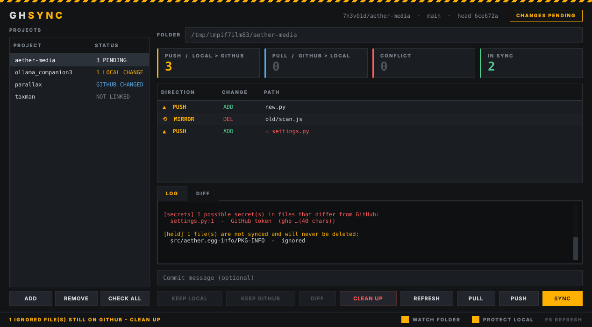

# ghsync

Keep a local folder and a GitHub repository in sync **without git** and without the 100-file browser upload limit. A single-file command-line tool, plus a dark industrial desktop GUI with a tray watcher that tells you when changes are waiting.



## Why

Uploading through github.com stops at 100 files per upload, and checking whether a local project still matches the repo meant downloading the zip and comparing folders in WinMerge. `ghsync` does that comparison for you and talks to GitHub's API directly, so any number of files goes up in one go.

## Features

- **Protect local (on by default).** Your folder is the single source of truth: nothing in it is ever replaced or deleted, and SYNC makes GitHub mirror it. See [Protect local](#protect-local).
- **No git required.** Pure Python standard library (3.8+) for the CLI. Only the GUI needs PyQt6.
- **No 100-file limit.** Files are uploaded through the GitHub REST API (Git Data endpoints).
- **Knows who changed what.** A three-way comparison (last synced state, your folder, GitHub) separates "changed here", "changed on GitHub" and "changed on both".
- **Conflicts are never overwritten.** Files changed on both sides are reported and left alone until you pick a side.
- **Safe by default.** `--dry-run` shows the plan, deletions ask for confirmation, and every transfer is hash-verified.
- **Never writes outside the folder.** Paths from GitHub are checked before anything touches the disk, and ghsync refuses to go through symlinks or junctions.
- **Only real deletions are deleted.** A file that is ignored, too big, unreadable or behind a link is *held*: left alone on both sides, never treated as deleted.
- **Your edits win a race.** If you save a file while a pull is running, that file is skipped, not overwritten.
- **Desktop GUI** with a live change list, coloured diffs, one-click push/pull/sync and per-file conflict resolution.
- **Tray watcher.** Polls the folder and GitHub in the background, shows a status-coloured tray icon and sends a notification when something new is waiting. It only notifies; it never syncs on its own.

## Requirements

- Python 3.8 or newer
- A GitHub personal access token (see below)
- `pip install PyQt6` for the GUI only

## Quick start

**1. Get a token.** On GitHub go to *Settings → Developer settings → Personal access tokens → Fine-grained tokens* and create one limited to the repositories you sync, with **Contents: read and write**. Add **Administration: read and write** only if you want `init` to create repositories for you. A classic token with the `repo` scope also works, but it can reach every repository you own.

**2. Sign in once.**

```
python ghsync.py login
```

The token is stored in `~/.ghsync_token` (plain text, so treat that file like a password). Alternatively set the `GITHUB_TOKEN` environment variable.

**3. Link a folder.** Run inside your project folder, or point at it with `-C <folder>`.

```
python ghsync.py init my-project            # create a new private repo and upload the folder
python ghsync.py init my-project --public   # ...or a public one
python ghsync.py link owner/repo            # ...or link a repo that already exists
```

Linking an existing repo is the easy way to adopt a project you previously uploaded by browser: identical files show as in sync and only the real differences appear. With Protect local on (the default), the first SYNC also clears out old files that exist only on GitHub. Every deletion is listed and confirmed first, so it replaces the old download-the-zip-and-WinMerge clean-up.

**4. Sync.**

```
python ghsync.py status     # what would be pushed / pulled / in conflict
python ghsync.py diff       # show the differences
python ghsync.py sync       # make GitHub mirror this folder (Protect local, the default)
```

## Protect local

Most of the time the folder on your PC is the real project and GitHub is just where it's stored. Protect local is built for that, and it is **on by default** for every project, including ones linked before 0.3.

**With Protect local on:**

| GitHub side | What SYNC does | Your folder |
|---|---|---|
| A file was edited on GitHub (web edit, another machine, a bot) | Puts your version back on GitHub | untouched |
| A file was deleted on GitHub | Restores your copy on GitHub | untouched |
| A file exists only on GitHub (old leftovers) | Deletes it from GitHub, after confirmation | untouched |
| You changed or deleted a file locally | Pushes the change, as always | untouched |
| Changed on both sides | Your version wins | untouched |
| Ignored, unsafe or otherwise *held* | Left alone on both sides | untouched |

Nothing in the folder is ever replaced or deleted. This is enforced twice: planning never produces a local write, and the code that writes local files refuses to run on its own. PUSH sends your changes, including your version of any conflict, but leaves files changed only on GitHub (and files that exist only there) alone. SYNC does all of that and also reverts and removes those. In the GUI, the files GitHub changed show as **⟲ MIRROR** rows, so you can see exactly what will be reverted or removed before you click SYNC. Mirroring is one commit, so anything it reverts or removes is still in GitHub's history.

**Taking something from GitHub on purpose** needs a one-time override:

- GUI: **PULL** (everything GitHub changed), or select MIRROR or conflict rows and press **KEEP GITHUB**. A dialog lists every file that would be replaced, deleted or added, with *No* as the default.
- CLI: `pull --allow-local-overwrite` (or `sync --prefer remote --allow-local-overwrite`).

The override applies to that one run only; protection stays on.

**Backups:** before ghsync replaces or deletes any local file, with protection on or off, it copies the current version to `.ghsync/backup/<date-time>/`, keeping the same folder layout. If a backup can't be written, that file is skipped, not overwritten. Backups are never synced; delete old ones when you no longer need them.

**Turning it off** (two-way sync, where changes made on GitHub are pulled in): `ghsync protect off`, or untick **PROTECT LOCAL** in the GUI, which asks you to confirm. `ghsync protect` shows the current setting, and `status` prints it on every run.

## Command reference

Global option: `-C <folder>` runs against a folder other than the current one (put it before the command: `python ghsync.py -C D:\site status`).

| Command | What it does |
|---|---|
| `login` | Store your GitHub token. |
| `init <name> [--public] [--org ORG] [--description TEXT] [-m MSG]` | Create a repo on GitHub, link this folder and upload everything. |
| `link <owner/repo> [--branch NAME]` | Link this folder to an existing repo (default branch unless given). |
| `status` | Compare folder and repo and show the plan. Changes nothing. |
| `protect [on\|off]` | Show or change Protect local for this folder. |
| `diff [paths...]` | Unified diff, GitHub to local. Binary files just report that they differ. |
| `push` / `pull` / `sync` | Send local changes, fetch remote changes, or sync. With Protect local on, `sync` mirrors the folder to GitHub and `pull` needs `--allow-local-overwrite`. |

Options for `push`, `pull` and `sync`:

| Option | Meaning |
|---|---|
| `-m "message"` | Commit message (default: `ghsync: N file(s) changed (timestamp)`). |
| `--dry-run` | Print the plan and stop. |
| `--yes` | Skip the deletion confirmation. |
| `--prefer local\|remote` | Resolve every conflict in favour of one side (`remote` needs the override while Protect local is on). |
| `--allow-local-overwrite` | One-time permission to replace or delete files in the folder while Protect local is on. They are backed up first. |

Each sync is one commit containing all the changes. It appears under your GitHub account.

## The GUI

```
python ghsync_gui.py                      # opens the last project you used
python ghsync_gui.py C:\Projects\my-site  # opens (and adds to the list) a specific folder
python ghsync_gui.py C:\Projects\my-site --tray   # starts hidden in the tray
```

Keep `ghsync_gui.py` and `ghsync_projects.py` in the same folder as `ghsync.py`.

### Projects (0.4)

The left panel lists every project folder you manage. Click one to open it in the sync view; everything below works exactly as before, on that one project.

- **ADD** a folder (linked or not), **REMOVE** it from the list, or **CHECK ALL** for a fresh status of every project. Removing only forgets the folder; its files, its `.ghsync/` settings and its GitHub repo are untouched.
- **Status column:** `IN SYNC`, `N LOCAL CHANGES`, `GITHUB CHANGED`, `BOTH CHANGED`, `NEVER SYNCED`, `NOT LINKED`, `ERROR` (hover for the reason) or `CLASH`. The open project shows its live count (`N PENDING`, `N CONFLICTS`). The others are checked in the background when the window opens and every 5 minutes, one project at a time, with one GitHub request each. The open project is never scanned in the background, so a status check can't collide with your sync.
- **One operation at a time.** You can't switch projects while a sync, push or pull is running. Results from a background scan of a project you've just left are discarded, never shown under the new one.
- **No bulk actions.** Every sync is started by you, on one project, with that project's own confirmation dialogs. Watching and notifications cover the open project.
- **Safety rules for the list:**
  - A folder is identified by its real location, so a junction or symlink pointing at a listed folder counts as the same folder.
  - Folders can't be nested inside each other. Like the next rule, this is enforced by the engine: a folder inside, or containing, a listed project is refused for `push`, `pull`, `sync`, `link` and `init` from the command line too. The listed project itself is unaffected.
  - Two projects can't sync to the same repo and branch, because with Protect local each would keep undoing the other. This is checked when adding and when linking. If it happens anyway (for example by editing a config by hand), the row shows `CLASH` and syncing that project is blocked until it's resolved.
  - **The engine enforces this rule, not just the window.** `push`, `pull`, `sync`, `link` and `init` from the command line refuse any folder, listed or not, whose repo and branch another listed project owns. `status`, `diff` and `--dry-run` stay available. If the project list can't be read, syncing is refused rather than allowed. With no project list at all (CLI-only use), nothing changes.
  - These are **admission checks**: they run when an operation starts, under that project's lock, against the project list as it is at that moment. Changing the list or a link while a sync is already running isn't detected until the next operation. No global lock is held while talking to GitHub.
  - Only listed folders can be open in the window. A folder that can't be added (nested, missing, clashing) is never opened, even when passed on the command line.
- **`IN SYNC` in the list** means no changes were detected since that project's last sync: its files match the recorded baseline and GitHub's branch hasn't moved. It isn't a file-by-file comparison with GitHub; opening the project gives the authoritative plan.
- The list lives in `%APPDATA%\ghsync\projects.json` (set `GHSYNC_HOME` to move it). If it's ever damaged, GHSYNC says so and leaves it untouched. The folder you last used in 0.3 is added automatically on first start; add your other projects with **ADD**.

- **First run on a folder:** save your token, then either create a new repo from the folder or link an existing one.
- **Counters and list:** PUSH, PULL, CONFLICT and IN SYNC counts sit above the list of every pending file, tagged ADD, MOD or DEL.
- **Actions:** SYNC, PUSH, PULL, REFRESH (or F5), plus an optional commit message. Double-click a file or press DIFF for a coloured diff.
- **PROTECT LOCAL** (bottom bar, on by default): files GitHub changed show as **⟲ MIRROR** rows and SYNC puts your version back. PULL and KEEP GITHUB become a one-time override that lists the affected files and backs them up first. Unticking it asks for confirmation.
- **Conflicts:** select the conflicting files and choose **KEEP LOCAL** (overwrite GitHub) or **KEEP GITHUB** (overwrite your copy). Each asks for confirmation.
- **Deletions** always ask first. The window also refreshes when you click back into it.
- **Logs stay with their job.** Each background job's output goes only to its own log, even when other work runs at the same time.

### Tray mode


Tick **WATCH FOLDER** at the bottom of the window (on by default). While it is on:

- The folder is checked every 5 seconds and GitHub's latest commit once a minute. A change is only re-compared after the folder has been quiet for one poll, so saving many files doesn't cause a flurry of checks.
- When something new is waiting you get a notification such as *"3 to push · 2 to pull"* with the first few file names. You get one per distinct set of changes, and none while the window is in front of you.
- Closing the window hides it to the tray. Right-click the icon for **Open**, **Sync now**, **Pause/Resume watching** and **Quit**.

To start it with Windows, put a shortcut to `pythonw ghsync_gui.py <folder> --tray` in the `shell:startup` folder. The polling rates are `LOCAL_POLL_MS` and `REMOTE_EVERY` at the top of the `Main` class in `ghsync_gui.py`.

## How it works

For every file `ghsync` computes the same SHA-1 that git uses for a blob, so it can compare your folder against GitHub's file tree without downloading anything. It also remembers the state at your last successful sync in a `.ghsync/` folder inside the project:

| File | Purpose |
|---|---|
| `.ghsync/config.json` | Which repo and branch this folder is linked to. |
| `.ghsync/state.json` | The last agreed state, the "base" of the three-way comparison. |
| `.ghsync/cache.json` | File size and modified-time cache so unchanged files aren't re-hashed. |

Comparing base, local and remote classifies each file:

| Local | GitHub | Result |
|---|---|---|
| changed | same as base | **push** |
| same as base | changed | **pull** |
| changed | changed differently | **conflict** (left untouched) |

Pushes create blobs, build a tree, commit and fast-forward the branch. If GitHub moved while you were pushing, it stops and asks you to run it again rather than overwrite anything.

### Safety model

A correct sync decision is not the same as a safe file operation, so 0.2 checks both.

- **One path policy for both sides.** Every path from GitHub is checked before it is classified: no `..`, no absolute paths, nothing under `.ghsync/` or `.git/`, no characters or device names Windows can't hold (`CON`, `a:b`, trailing dots). Your ignore rules apply to GitHub's files too, so an ignored `.env` on GitHub is not pulled. Symlinks and submodules on GitHub are reported and left alone.
- **Contained writes.** Before writing or deleting, every parent folder is checked to be a real folder, and a symlink, junction or other redirecting reparse point is refused. The check runs again right before the final rename, and the rename replaces a link rather than following it. OneDrive placeholders are treated as ordinary files.
- **Held files.** A path is only treated as deleted when it is confirmed absent. Anything ignored, over 100 MB, unreadable, behind a link or otherwise unsure is *held*: listed in `status` under **HELD**, never pushed, pulled or deleted, and its last agreed state is kept.
- **Pull preconditions.** Downloads go to a temp file first. Right before a file is replaced or deleted, its current content is compared with what the scan saw. If it changed, that file is skipped (your edit is kept) and it shows up again on the next run, usually as a conflict.
- **One operation at a time.** Every push, pull, sync, link or init holds an OS-level lock on `.ghsync/lock`. A second ghsync (another window, the CLI, the tray) is refused with the owner's PID. The OS releases the lock if the process dies, so a crash never leaves a stale lock behind.
- **Atomic state.** `state.json`, `config.json` and `cache.json` are written to a temp file, flushed and renamed, so a crash leaves the previous version intact. A damaged `state.json` stops the run with instructions instead of being silently reset. Pull results are saved before the push starts. If a pull is interrupted, the next run removes its leftover temp files, but only ones ghsync can prove it created: each pull records a run ID in `.ghsync/journal.json` before writing any temp file, and cleanup deletes only exact `.ghsync-<run id>-<n>.ghsync-tmp` names from a recorded run. Your own files are never deleted by cleanup, whatever they're called.
- **GitHub lag can't roll you back.** Right after the branch moves, GitHub can briefly report the previous commit. Whenever the branch has moved since the last sync, GitHub's compare service must confirm the new head is *ahead* of the last-synced commit (normal progress) or *diverged* from it (a force-push). If it's *behind*, or GitHub can't answer, ghsync waits and checks again, and refuses if that persists. An unknown answer is never treated as safe. If you rolled the branch back on GitHub on purpose, replaced it with unrelated history, or re-linked the folder to a different repo, delete `.ghsync/state.json` and sync again.
- **Approval is bound to execution.** The GUI fingerprints the exact plan you confirmed. If the folder or GitHub changed in between, nothing runs and the list refreshes.

**Recovering from an interruption:** just run `sync` again. Files already transferred compare equal on both sides and are recorded as in sync; anything unfinished is planned again. If `state.json` is ever damaged, delete it and run `status`: with no previous state ghsync never deletes anything, and differing files show as conflicts.

To unlink a folder, delete its `.ghsync/` directory. To sign out, delete `~/.ghsync_token`.

## Ignore rules

Skipped by default: `.git/`, `.ghsync/`, `node_modules/`, `__pycache__/`, `*.pyc`, `.DS_Store`, `Thumbs.db`, `desktop.ini`, `.env`, `.venv/`, `venv/`, `*.ghsync-tmp`. That last suffix is reserved: files ending in it are never synced, but ghsync never deletes them either unless it created them itself.

ghsync honours **all** of these ignore files in the project root, each read on its own:

| File | Typically written for |
|---|---|
| `.ghignore` | ghsync only |
| `.gitignore` | git, and any tool that follows it |
| `.packagerignore` | Project Packager (e.g. `docs/internal/` review notes that shouldn't ship) |

A path matched by **any** of them is not synced, in either direction. ghsync only reads these files; it never writes to them or combines them, so each tool keeps its own. If one of them exists but can't be read (not valid UTF-8, a link, permission denied), the sync stops instead of going ahead without those exclusions. A UTF-8 BOM and Windows line endings are fine. `status` shows which files are in effect.

The matching is a **subset** of `.gitignore` syntax: `name`, `*.ext`, `dir/`, `/anchored` and `path/with/slash` globs. Negation / force-include (`!pattern`) lines are skipped: ghsync never un-ignores, because that could upload something another tool was told to keep out (`\!name` still means a literal `!name`). `**` is treated as an ordinary `*`, and only the ignore files in the project root are read, not ones in subfolders. If you rely on fuller `.gitignore` behaviour, write a `.ghignore` that spells out what you mean.

Ignore rules apply to both sides. Ignoring a file that was already synced does **not** delete it from GitHub; it just stops being synced. Delete it on GitHub yourself if you want it gone.

## Limitations and rough edges

- **Not a git replacement.** There is no history browsing, no branches (it syncs one branch), and conflicts are resolved by choosing a whole file, not by merging text.
- **GitHub's placeholder README after `init`.** GitHub creates one when the repo is created. With Protect local on, the first sync replaces it with your `README.md`, or removes it if you don't have one. With protection off, an existing local `README.md` shows as a conflict once; resolve it with *KEEP LOCAL*.
- **Comparison is byte for byte.** There is no line-ending normalisation, so a file with CRLF locally and LF on GitHub counts as changed.
- **Files over 100 MB are skipped** (GitHub's limit). Very large files upload through the REST API as base64 and can be slow.
- **Empty folders and symlinks are not synced.** Local symlinks and junctions are skipped (and listed as held); symlinks and submodules on GitHub are left alone. Existing files keep their executable bit on both sides; new files are created as non-executable.
- **Known issue (GHS-010, low):** if a pull is killed mid-write and that folder is then added to your ignore rules, the leftover `.ghsync-<id>-<n>.ghsync-tmp` file there isn't cleaned up. It's harmless and never synced; delete it by hand. A fix is planned.
- **Backups survive crashes, not necessarily power cuts.** Each backup file is flushed to disk before the original is touched, but the folder entry that names it isn't separately flushed. After a sudden power loss, a backup made in the last moments could be missing. For anything irreplaceable, keep a separate backup as well.
- **Remaining race window.** The containment checks run immediately before each rename, but on Windows there is no way to rule out a folder being swapped for a junction in the instant between the check and the rename. That would need someone actively racing ghsync on your own machine; a hostile repository alone can't do it.
- **Very large repos:** if GitHub truncates the file listing, `ghsync` refuses to sync rather than guess.
- **The token is stored in plain text** in `~/.ghsync_token`. Use a fine-grained token limited to the repos you sync. Windows Credential Manager support is planned.

## Status

0.4.2: the no-nesting rule is enforced by the engine as well, for every entry point (GHS-016). 0.4.1: the one-folder-per-branch rule is enforced by the engine, so the CLI obeys it too (GHS-014); a folder that fails registration can't be opened (GHS-015); the project list is validated on load. The engine's only change since 0.3.4 is that added check. 0.4.0: **multi-project GUI** (above). 0.3.4: fixes a GUI bug where a confirmed SYNC could be silently dropped when closing the confirmation dialog started a refresh. 0.3.3: with Protect local on, PUSH sends your version of conflicts too (before, it left them untouched). 0.3.2: the stale-branch guard fails closed when GitHub can't confirm the branch relationship (GHS-011). 0.3.1: guards against GitHub briefly reporting an older branch head, which could otherwise roll a two-way sync back to old content. 0.3.0: **Protect local**, on by default (above), plus backups of every local file a pull replaces or deletes. 0.2.2: `.gitignore` and `.packagerignore` are always honoured alongside `.ghignore`. 0.2.1, "Safe Sync". 0.2 fixed the filesystem-safety, concurrency and recovery findings from an independent review (GHS-001 to GHS-008); 0.2.1 fixes the one defect found in the follow-up review (GHS-009: temp cleanup could delete user files ending in `.ghsync-tmp`). No new features.

The regression suite in `tests/` runs against an in-memory GitHub, over real HTTP for the CLI, and drives the real GUI offscreen. Every fix and feature has a test that fails on the build before it and passes on the current one. On Windows the suite also creates real NTFS junctions (`mklink /J`, no admin rights needed) and uses the real `msvcrt` lock.

```
run_tests.bat                                   # or: python -m unittest discover -s tests -v
python tests\smoke_real_github.py you/throwaway --i-understand you/throwaway
```

The second command runs the same scenarios against the **real** GitHub API on a disposable repository you create first (it must have at least one commit). Run it once on your machine before trusting the tool with real work: it is the one check that can't be done without your token and your Windows setup.

## Files

```
ghsync.py        command-line tool and sync engine
ghsync_gui.py    PyQt6 desktop GUI: project list, sync view, tray watcher
ghsync_projects.py  project registry and dashboard status (Qt-free, uses ghsync.py)
run_tests.bat    runs the regression suite
tests/           regression tests, fake GitHub, real-GitHub smoke test
docs/            screenshots used in this README
```
